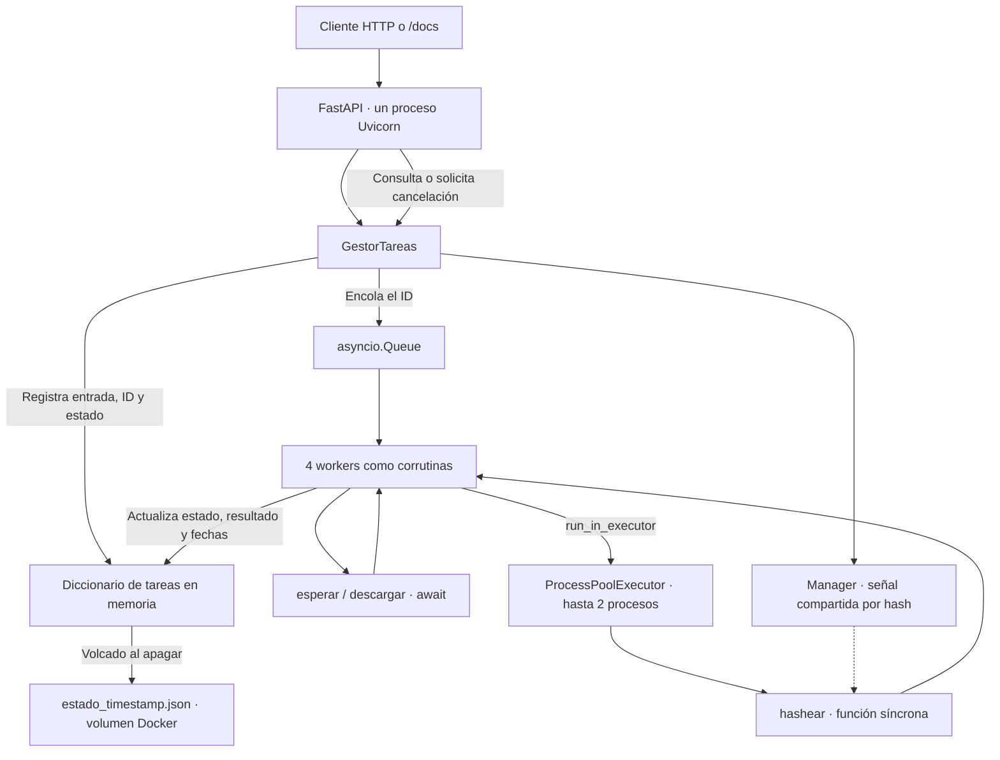

# TP Nº 2 — Plataforma de tareas distribuidas

**Computación II · Universidad de Mendoza · 2026**  
**Autor:** Gerónimo Giordano

API HTTP para recibir trabajos, encolarlos y ejecutarlos concurrentemente.
Permite consultar estados y resultados, cancelar trabajos pendientes o activos
y obtener estadísticas. El estado se mantiene en memoria y se vuelca a JSON
durante el apagado ordenado.

La distribución del trabajo es local: un contenedor contiene el proceso de la
API, las corrutinas de workers y los procesos auxiliares para calcular hashes.
No se utiliza una base de datos ni un framework externo de colas.

## 1. Ejecución y uso

### Requisitos y arranque

Se necesita Docker con Docker Compose. No hace falta instalar Python en el
host para ejecutar la API.

Después de clonar el repositorio, desde su raíz:

```bash
cd tp2
docker compose up --build
```

Si la terminal ya está en `tp2`, ejecutar solamente el segundo comando.

- API: <http://localhost:8000>.
- Documentación interactiva: <http://localhost:8000/docs>.
- Contrato OpenAPI: <http://localhost:8000/openapi.json>.

La publicación del puerto está limitada a `127.0.0.1` en el host. Dentro del
contenedor, Uvicorn escucha en `0.0.0.0:8000`.

### Endpoints

| Método   | Ruta                 | Comportamiento                                                           |
| -------- | -------------------- | ------------------------------------------------------------------------ |
| `POST`   | `/tareas`            | Valida, registra y encola; responde `202` con ID y estado inicial.       |
| `GET`    | `/tareas`            | Lista registros; admite `?estado=pendiente`, por ejemplo.                |
| `GET`    | `/tareas/{tarea_id}` | Devuelve entrada, estado, resultado, error y fechas.                     |
| `DELETE` | `/tareas/{tarea_id}` | Cancela una tarea pendiente o activa; si ya terminó, conserva su estado. |
| `GET`    | `/estadisticas`      | Devuelve totales por estado, duración promedio y workers ocupados.       |

Los IDs son UUID. Un ID válido pero inexistente devuelve `404`; un formato
inválido o una entrada que no cumple el modelo devuelve `422`. Si el gestor
dejó de aceptar trabajos, el `POST` devuelve `503`.

### Crear y consultar una espera

```bash
curl -i -X POST http://localhost:8000/tareas \
  -H 'Content-Type: application/json' \
  -d '{"tipo":"esperar","segundos":20,"timeout":30}'
```

El `POST` devuelve el ID inmediatamente, sin esperar los 20 segundos. Copiar
ese UUID en la variable siguiente para consultar o cancelar ese trabajo:

```bash
TAREA_ID="PEGAR_AQUI_EL_UUID_DEVUELTO"

curl "http://localhost:8000/tareas/$TAREA_ID"
curl http://localhost:8000/tareas
curl 'http://localhost:8000/tareas?estado=ejecutando'
curl -X DELETE "http://localhost:8000/tareas/$TAREA_ID"
curl http://localhost:8000/estadisticas
```

### Descargar URLs

```bash
curl -i -X POST http://localhost:8000/tareas \
  -H 'Content-Type: application/json' \
  -d '{"tipo":"descargar","urls":["https://example.com","https://www.python.org"],"timeout":30}'
```

Al consultar la tarea terminada, `resultado.descargas` contiene un elemento
por URL, con `codigo`, `tamano` en bytes y `duracion` en segundos. El contenido
se descarga en memoria; no se guarda como archivo ni se devuelve su cuerpo.
Si una URL produce un error de conexión o de red, su elemento contiene `error`
y `tipo_error`, sin descartar los resultados de las otras URLs.

Un HTTP `404` o `500` se registra como respuesta HTTP con sus metadatos.
La tarea puede quedar `completada` aunque alguna o todas sus URLs tengan errores:
ese estado indica que terminó la recopilación del informe de descargas.

### Calcular un hash

```bash
curl -i -X POST http://localhost:8000/tareas \
  -H 'Content-Type: application/json' \
  -d '{"tipo":"hashear","texto":"Computacion II","iteraciones":1000000,"timeout":30}'
```

El texto se codifica en UTF-8. En cada iteración se calcula SHA-256 sobre los
bytes anteriores; el resultado final se devuelve en hexadecimal junto con la
cantidad de iteraciones. Las iteraciones deben ser mayores que cero.

### Probar un timeout

```bash
curl -i -X POST http://localhost:8000/tareas \
  -H 'Content-Type: application/json' \
  -d '{"tipo":"esperar","segundos":10,"timeout":1}'
```

Después de vencer el segundo de ejecución, la tarea pasa a `fallida` y su
campo `error` indica que excedió el tiempo máximo. El timeout no incluye el
tiempo pendiente en la cola. Si se omite, vale 30 segundos. Debe ser positivo
y finito; `segundos` admite cero, pero no valores negativos o infinitos.

### Configuración

| Parámetro                            | Valor predeterminado | Dónde se define                                |
| ------------------------------------ | -------------------: | ---------------------------------------------- |
| Workers como corrutinas              |                    4 | Variable de entorno `CANTIDAD_WORKERS`.        |
| Procesos del executor                |                    2 | Variable de entorno `PROCESOS_CPU`.            |
| Timeout de una tarea                 |                 30 s | Campo `timeout` del JSON de entrada.           |
| Espera voluntaria al apagar          |                 20 s | Argumento `plazo` de `GestorTareas.detener()`. |
| Plazo externo de Docker para detener |                 30 s | `stop_grace_period` en Compose.                |
| Directorio de volcados               |       `/app/estados` | Argumento `directorio` del gestor.             |

Los dos primeros parámetros se leen dentro del contenedor. Para cambiarlos
con Compose, agregar bajo el servicio `api`, por ejemplo:

```yaml
environment:
  CANTIDAD_WORKERS: "8"
  PROCESOS_CPU: "2"
```

Se utiliza un solo proceso de Uvicorn. Sus workers de servidor no deben
confundirse con los workers de la aplicación: varios procesos de Uvicorn
tendrían diccionarios y colas independientes.

## 2. Arquitectura y recorrido de una tarea



1. FastAPI valida el JSON mediante los modelos de Pydantic.
2. `crear_tarea()` genera el UUID y el registro `pendiente`, y encola su ID.
3. El endpoint devuelve `202`. La ejecución ocurre después, fuera de esa petición.
4. Un worker obtiene el ID con `await cola.get()`, marca `ejecutando` y registra
   la fecha de inicio. Cada worker atiende un trabajo por vez.
5. `_ejecutar()` selecciona la función. I/O usa corrutinas; el hash se envía al
   executor. Una tarea de descarga puede contener varias peticiones concurrentes.
6. El worker guarda el resultado o el error, registra la finalización y llama
   a `task_done()`. Después vuelve a esperar otro ID.

Recorridos de estado:

```text
pendiente → ejecutando → completada
                      → fallida       (excepción o timeout)
                      → cancelada     (solicitud de cancelación)
pendiente             → cancelada     (solicitud o apagado)
```

### Organización del código

| Archivo                            | Responsabilidad                                                        |
| ---------------------------------- | ---------------------------------------------------------------------- |
| [`src/main.py`](src/main.py)       | Endpoints, respuestas HTTP y ciclo de vida de FastAPI.                 |
| [`src/modelos.py`](src/modelos.py) | Entradas, estados y registro `Tarea`.                                  |
| [`src/gestor.py`](src/gestor.py)   | Cola, workers, executor, cancelación, tiempos, estadísticas y apagado. |
| [`src/tareas.py`](src/tareas.py)   | Implementaciones de espera, descarga y hash.                           |
| [`mediciones/`](mediciones/)       | Scripts y resultados de los experimentos.                              |

## 3. Decisiones de diseño

### Cola asíncrona y estado compartido

Se eligió `asyncio.Queue` porque sus operaciones de espera cooperan con el
event loop. Cuando no hay trabajo, `await cola.get()` suspende al worker sin
mantener ocupado el hilo. Una llamada bloqueante a `queue.Queue.get()` dentro
de ese mismo hilo podría impedir que avanzaran la API y los otros workers.

El diccionario de tareas se manipula desde el event loop. Las actualizaciones
relacionadas se hacen sin `await` entre ellas, por lo que otra corrutina no se
intercala durante esas secuencias. Los procesos del hash no modifican ese
diccionario: reciben la entrada y devuelven un resultado. Por eso no se necesita
un `Lock` para el estado de tareas en este diseño. Si se accediera a él desde
otros hilos o procesos, esa justificación dejaría de ser suficiente.

`put_nowait()` permite encolar sin esperar capacidad porque la cola actual no
tiene tamaño máximo. Es una decisión simple para el TP, con el costo de no
aplicar contrapresión cuando llega más trabajo del que puede procesarse.

### I/O asíncrono y elección de HTTPX

Se utiliza `httpx.AsyncClient` porque ofrece peticiones HTTP compatibles con
`async`/`await`, metadatos de respuesta y cierre mediante `async with`. Un
cliente se comparte entre las URLs de una misma tarea. `asyncio.gather()`
permite que sus esperas de red se superpongan; un `for` que hiciera `await`
de cada descarga antes de iniciar la siguiente sería secuencial.

`return_exceptions=True` permite recopilar los errores de red por URL y esperar
las demás descargas. Las excepciones inesperadas se propagan al worker. No se
utiliza `requests`, de acuerdo con la restricción de la consigna.

### CPU fuera del event loop

El bucle del hash no tiene esperas de I/O. Declararlo con `async def` no haría
que cediera el hilo: ejecutarlo directamente congelaría el event loop durante
el cálculo. Por eso `hashear()` es síncrona y se invoca mediante
`loop.run_in_executor()` con `ProcessPoolExecutor`.

Los procesos permiten paralelismo de CPU sin compartir el GIL del proceso de
la API. En este algoritmo, después de la primera vuelta cada entrada del hash
tiene solo 32 bytes; no se depende de que los hilos liberen el GIL durante el
cálculo. El worker espera el resultado con `await`, dejando avanzar el servidor.

Se selecciona `spawn` explícitamente para el manager y el executor. Así se usa
el mismo método de arranque en macOS y Linux. Las funciones del cálculo están
definidas a nivel de módulo y los scripts protegen su entrada con
`if __name__ == "__main__"`. El arranque normal del servidor lo realiza Uvicorn.

### Cancelación y recursos a medio usar

- **Pendiente:** se marca `cancelada`. El ID permanece en la cola hasta que un
  worker lo obtiene, lo saltea y llama a `task_done()`; no llega a ejecutarlo.
- **Espera o descarga activa:** se cancela la `asyncio.Task` de esa ejecución,
  separada de la corrutina del worker. La cancelación se propaga en los `await`.
  En las descargas, el cierre del `async with` libera el cliente y sus conexiones;
  no quedan archivos parciales porque el cuerpo se almacena en memoria.
- **Hash activo:** cancelar el objeto que espera al executor no detiene por sí
  solo un cálculo ya iniciado. Cada hash recibe un evento compartido mediante
  `multiprocessing.Manager`; ante la cancelación se activa la señal y el cálculo
  la comprueba cada 10.000 iteraciones, lanzando `HashCancelado` para salir.

`asyncio.shield()` conserva el futuro del executor cuando se cancela la
corrutina que lo espera. Eso permite activar la señal y esperar la terminación
real del cálculo antes de liberar al worker. Una señal `asyncio.Event` adicional
confirma que el worker ya actualizó estado, fechas y referencias antes de
responder al `DELETE`, incluso ante varias solicitudes simultáneas.

La cancelación del propio worker, utilizada al cerrar el gestor, se distingue
de la cancelación del trabajo para no perder workers con cada `DELETE`.

### Timeouts, errores y continuidad de los workers

`asyncio.timeout()` limita cada ejecución. Al vencer solicita cancelación,
espera la limpieza y se registra `fallida` con el motivo. Una cancelación pedida
por el cliente produce `cancelada`. El cierre puede terminar ligeramente
después del timeout porque no abandona los recursos todavía activos.

El worker captura las excepciones ordinarias de la ejecución, registra su tipo
y mensaje y continúa con otro trabajo. El `finally` registra el fin, limpia
referencias y confirma la atención del elemento con `task_done()`, haya salido
bien o mal. Esta confirmación permite que `cola.join()` espere los trabajos
atendidos, no solamente que la cola se haya quedado sin IDs.

Si una excepción escapa por completo del worker, su corrutina termina y se
reduce la capacidad del pool. No existe un supervisor que lo reinicie. No debe
confundirse el manejo de errores de cada trabajo con una garantía de recuperación
ante cualquier fallo interno del gestor.

### Apagado y persistencia mínima

El `lifespan` inicia el gestor antes de atender peticiones y ejecuta `detener()`
al cerrar. Uvicorn maneja `SIGTERM` y `SIGINT`; no se instala un segundo manejador
que compita con él. El cierre sigue esta secuencia:

1. Rechazar nuevas tareas y marcar las pendientes como canceladas.
2. Dar hasta 20 segundos a las que están en ejecución.
3. Si vence el plazo, solicitar su cancelación y esperar la limpieza.
4. Detener los workers, cerrar el executor y después el manager.
5. Serializar los registros con `model_dump(mode="json")` y escribir
   `/app/estados/estado_<timestamp>.json`, con timestamp UTC y microsegundos.

Las operaciones bloqueantes del manager, el cierre del executor y la escritura
del JSON se desplazan a hilos mediante `asyncio.to_thread()`.

El volumen nombrado `estados` conserva los archivos al recrear el contenedor.
Al iniciar se buscan los volcados y se informa por log la cantidad y el más
reciente. **No se restauran automáticamente las tareas anteriores**: la consigna
exige reportar el volcado, no recuperar su ejecución.

Para observarlo:

```bash
docker compose stop
docker compose up -d
docker compose logs api
docker compose exec api ls -l /app/estados
```

Los 20 segundos son el plazo de espera voluntaria, no un límite absoluto para
toda la limpieza. Docker concede 30 segundos antes de forzar la salida. Un
proceso que no coopere o un cierre anormal puede impedir terminar el volcado.

### Estadísticas

`GET /estadisticas` cuenta todos los registros por estado. Su promedio usa
`finalizada_en - iniciada_en` de las tareas con ambas fechas, incluidas las
fallidas y las canceladas después de empezar; no incluye la espera en cola.
`workers_ocupados` cuenta tareas `ejecutando`, también cuando su worker espera
un proceso libre del executor. No es un contador histórico de usos del worker.

## 4. Mediciones y resultados

Se utilizan los JSON guardados en [`mediciones/resultados/`](mediciones/resultados/),
correspondientes al **02/11/2026**. Cada escenario tiene tres repeticiones. Los
tiempos se miden con `time.perf_counter()`; el p95 se calcula por rango más
próximo. Con pocas muestras, ese percentil es descriptivo, no una garantía para
cualquier carga futura.

### Entornos y alcance

| Experimento                 | Entorno registrado                                                                                                              |
| --------------------------- | ------------------------------------------------------------------------------------------------------------------------------- |
| I/O y bloqueo del loop      | Docker, Linux aarch64, Python 3.13.18, 3 CPU lógicas visibles. FastAPI 0.162.0, Uvicorn 0.54.0, HTTPX 0.28.1 y Pydantic 2.14.2. |
| Generador de carga del pool | macOS arm64, Python 3.14.7, 8 CPU lógicas visibles en el host, HTTPX 0.28.1. Peticiones a `http://127.0.0.1:8000`.              |

La configuración actual de la API en Docker se verificó con 4 workers y 2
procesos de CPU; el JSON del pool registra los 4 workers, pero no guarda por sí
solo el número de procesos ni los recursos del servidor. Las 8 CPU del generador
en macOS no son las 3 visibles dentro de Docker.

Los registros Linux indican `cpu.max = max 100000` y `memory.max = max`: no hay
una cuota adicional en esos cgroups. Eso no significa recursos ilimitados; la
máquina virtual de Docker sigue teniendo su propia asignación. Los JSON no
registran el modelo físico de CPU ni la memoria asignada a esa máquina virtual.

### 4.1. Veinte descargas: secuencial frente a concurrente

Fuente: [`concurrencia_io.json`](mediciones/resultados/concurrencia_io.json).

Se descargan 20 cuerpos de 1 KiB desde un servidor local, con demora fija de
0,2 segundos por petición. El modo secuencial llama a `descargar()` una vez por
URL y espera cada resultado. El concurrente llama a la misma función con las
20 URLs. Se alterna el orden de los escenarios entre repeticiones.

|  Repetición | Secuencial (s) | Concurrente (s) |
| ----------: | -------------: | --------------: |
|           1 |         4.3696 |          0.2623 |
|           2 |         4.3500 |          0.2424 |
|           3 |         4.3694 |          0.2529 |
| **Mediana** |     **4.3694** |      **0.2529** |

```text
speedup = mediana secuencial / mediana concurrente
        = 4.369448793 / 0.252912791
        = 17.28 veces
```

La espera de red se acumula en la versión secuencial y se superpone en la
concurrente. El tiempo concurrente se acerca al de una petición, más los costos
de preparar y coordinar las descargas. No se obtiene exactamente 20 veces de
mejora porque existen costos de cliente, conexiones y servidor.

Esta medición prueba la función de descarga, sin API ni cola. También incluye
la creación de clientes: 20 llamadas individuales en el caso secuencial frente
a una llamada conjunta en el concurrente. Por eso el speedup corresponde a
estos dos usos de la implementación, no únicamente al costo aislado de `gather`.
El servidor local controla las condiciones; no representa el rendimiento de
20 sitios arbitrarios de Internet.

### 4.2. Latencia de la API durante trabajo de CPU

Fuente: [`bloqueo_loop.json`](mediciones/resultados/bloqueo_loop.json).

Se ejecuta el mismo hash de **5.000.000 de iteraciones** en dos APIs temporales:
una llama deliberadamente al cálculo en el event loop y la otra usa el executor.
Una marca escrita al comenzar el cálculo permite enviar `GET /tareas` durante
el hash. El pool se calienta antes y se verifica que los hashes finales coincidan.
La variante bloqueante existe solo en el experimento, no en el servidor normal.

|  Repetición | GET sin executor (ms) | GET con executor (ms) |
| ----------: | --------------------: | --------------------: |
|           1 |              1247.702 |                 0.389 |
|           2 |              1313.820 |                 0.375 |
|           3 |              1300.909 |                 0.355 |
| **Mediana** |          **1300.909** |             **0.375** |

Sin executor, el GET respondió cuando el hash ya figuraba `completada`: el
event loop no pudo atenderlo durante el cálculo. Con executor, respondió cuando
la tarea seguía `ejecutando`. El cálculo duró aproximadamente 1,25–1,31 segundos
en ambos escenarios; la mejora observada es la disponibilidad del servidor,
no una reducción comparable del tiempo del hash.

### 4.3. Techo del pool bajo carga de CPU

Fuente: [`techo_pool.json`](mediciones/resultados/techo_pool.json).

Se enviaron lotes crecientes de hashes de **1.000.000 de iteraciones**, con
timeout de 60 segundos, tres repeticiones por tamaño. Cada lote termina antes
de comenzar el siguiente. La aplicación conserva 4 workers y su configuración
actual de 2 procesos CPU. El seguimiento de cada tarea consulta su estado cada
0,02 segundos; una conexión separada sondea `GET /tareas` cada 0,1 segundos,
más el tiempo que tarde la petición.

El tiempo total es el observado por el cliente desde el envío hasta detectar
la finalización. La cola y la ejecución se calculan con las fechas del servidor.
El throughput es la cantidad de tareas completadas dividida por la duración del
lote; se informa la mediana de las tres repeticiones. Los otros promedios y p95
se calculan sobre las muestras individuales reunidas por carga.

| Tareas por lote | Total medio (s) | Total p95 (s) | Cola media (s) | Ejecución media (s) | Completadas/s | GET p95 (ms) |
| --------------: | --------------: | ------------: | -------------: | ------------------: | ------------: | -----------: |
|               1 |           0.296 |         0.303 |       0.000164 |               0.281 |          3.33 |        4.568 |
|               2 |           0.302 |         0.312 |       0.000148 |               0.285 |          6.53 |        4.592 |
|               4 |           0.441 |         0.587 |       0.000209 |               0.422 |          6.89 |        4.941 |
|               8 |           0.790 |         1.363 |          0.228 |               0.538 |          6.71 |        9.532 |
|              16 |           1.335 |         2.347 |          0.762 |               0.542 |          6.81 |        6.999 |
|              32 |           2.952 |         5.395 |          2.228 |               0.662 |          5.72 |       20.782 |

No se registraron tareas fallidas o canceladas ni errores en los GET del sondeo.
El GET sin carga tuvo media de **1.568 ms** y p95 de **1.671 ms** sobre cinco muestras.

**Interpretación del límite.** Pasar de una a dos tareas casi duplica el
throughput, de 3,33 a 6,53 tareas/s. Desde dos a cuatro aparece una zona cercana
al techo observado: con cuatro tareas se obtienen 6,89 tareas/s, y aumentar a
ocho o dieciséis no agrega capacidad comparable. En cambio, suben el tiempo
total y la espera. Con 32, el throughput baja a 5,72 tareas/s y la cola media
llega a 2,228 segundos. La mayor carga no hace que el sistema termine más hashes
por segundo.

El patrón es compatible con dos procesos calculando hashes: cuatro workers
pueden tomar trabajos, pero no crean cuatro lugares de cálculo en el executor.
Por eso, con cuatro tareas la cola del gestor todavía es casi nula, mientras
crece la duración registrada como ejecución, que incluye la espera dentro del
executor. Con ocho o más tareas también crece la cola anterior a los workers.
Ese tiempo de ejecución no debe interpretarse como tiempo exclusivo de CPU.

La API siguió respondiendo durante los cálculos, aunque su latencia no permaneció
constante. A 32 tareas, el p95 del GET fue 20,782 ms y hubo una muestra de
**258,415 ms**. No se observó una caída, pero sí degradación de tiempos. Los
datos no aíslan la causa de todos los picos: pueden intervenir planificación,
competencia por recursos, consultas de seguimiento y serialización de respuestas.

**Alcance de esta conclusión.** La corrida comenzó con **193 tareas previas en
memoria**; el calentamiento y los lotes agregaron más registros. `GET /tareas`
lista todo ese historial, por lo que el tamaño de su respuesta también aumenta.
Además, los sondeos y la generación de carga tienen costo. Estos resultados
describen esta ejecución y configuración, no un máximo universal de tareas ni
un punto exacto donde la aplicación dejará de funcionar. Una repetición con la
API recién iniciada permitiría controlar mejor el efecto del historial.

### Reproducir las mediciones

Las instrucciones completas, incluidas las variantes para ejecutarlas en Docker,
están en [`mediciones/README.md`](mediciones/README.md). Desde `tp2`, con las
dependencias de `requirements.txt` instaladas en el Python local:

```bash
python3 -m mediciones.concurrencia_io
python3 -m mediciones.bloqueo_loop
python3 -m mediciones.techo_pool
```

El tercer script necesita la API encendida y sin otros trabajos activos. Los
dos primeros crean sus servidores temporales. Los tres conservan muestras y
condiciones en JSON. Para comparar corridas, mantener fijos workers, procesos,
iteraciones, intervalos de consulta y recursos disponibles.

## 5. Conceptos del curso aplicados

La numeración siguiente corresponde a las referencias indicadas en la consigna.

| Clases   | Concepto                                    | Aplicación en el proyecto                                                                                                                                      |
| -------- | ------------------------------------------- | -------------------------------------------------------------------------------------------------------------------------------------------------------------- |
| 11       | Productor-consumidor                        | Los endpoints producen IDs para `asyncio.Queue`; los workers los consumen. Se adapta el patrón a corrutinas.                                                   |
| 13–14    | Sockets TCP y servidores concurrentes       | Uvicorn recibe las conexiones HTTP y HTTPX abre las conexiones de salida; las bibliotecas encapsulan el manejo directo de sockets.                             |
| 17       | Multiplexación de I/O: `select` y `epoll`   | El event loop puede esperar disponibilidad de varias conexiones sin dedicar un hilo bloqueado a cada descarga. El mecanismo concreto depende de la plataforma. |
| 18       | Corrutinas y `async`/`await`                | Los workers se suspenden en la cola y en las esperas de I/O. Una corrutina se programa con `create_task()`; definirla no crea paralelismo de CPU.              |
| 19       | HTTP y FastAPI                              | Métodos y rutas, modelos de entrada, códigos `202`, `404`, `422` y `503`, y documentación OpenAPI.                                                             |
| 20–21    | Asyncio en red y avanzado                   | `AsyncClient`, `gather`, cancelación, timeouts, `shield`, cola y ciclo de vida de los trabajos.                                                                |
| 22       | `concurrent.futures`                        | `ProcessPoolExecutor` y futuros para ejecutar el hash fuera del proceso de la API y esperar su resultado.                                                      |
| Bloque 0 | Context managers, decoradores y generadores | Decoradores de rutas, `async with` y `@asynccontextmanager`: el `yield` del lifespan separa inicio y limpieza.                                                 |

La distinción I/O-bound/CPU-bound se observa en las mediciones: esperar la red
permite superponer operaciones en un hilo, mientras que un bucle de cálculo
necesita salir de ese hilo para mantener disponible el servidor. Por el mismo
motivo, `esperar()` usa `asyncio.sleep()`; `time.sleep()` bloquearía el event loop
si se llamara directamente desde esa corrutina.

## 6. Limitaciones conocidas

- **Estado volátil.** El volcado se hace al cerrar normalmente; un `SIGKILL`,
  corte de energía o fallo antes de escribirlo puede perder el estado actual.
  No hay restauración automática, reanudación ni persistencia por cada cambio.
- **Carga sin límites globales.** La cola y el historial no tienen tamaño máximo,
  no hay limpieza de registros ni paginación, y no se limita la cantidad de URLs
  o iteraciones. Miles de trabajos pueden aumentar el uso de memoria y las
  esperas; el primer recurso agotado dependerá de las entradas. No se midió un
  umbral de caída con 10.000 tareas.
- **Workers compartidos entre tipos.** Si todos esperan hashes, las tareas I/O
  nuevas también quedan en cola. No hay pools separados por tipo ni prioridades.
- **Descargas en memoria.** Cada respuesta completa se conserva hasta armar el
  resultado. Archivos grandes o muchas URLs simultáneas pueden consumir mucha
  RAM. Se crea un cliente por tarea, no uno compartido por toda la aplicación.
- **Dos niveles de timeout.** HTTPX conserva su timeout de red predeterminado,
  además del límite global de la tarea. Un error de red puede quedar registrado
  para una URL antes de que venza el timeout global. No se siguen redirecciones
  automáticamente.
- **Cancelación cooperativa.** El hash consulta la señal cada 10.000 vueltas;
  no se interrumpe instantáneamente. La limpieza posterior al plazo de apagado
  no tiene un límite duro adicional dentro del gestor.
- **Sin supervisión ni distribución entre máquinas.** No se reinician workers
  caídos ni se comparten estado y cola entre réplicas. El servicio está pensado
  para una única instancia local. Tampoco implementa autenticación o rate limiting.
- **Verificación sin suite de regresión incluida.** Durante el desarrollo se
  comprobaron endpoints, validación, hash, cancelación, timeouts, continuidad de
  workers, cierre por señales y volcados. No se incluye una suite persistente de
  `pytest-asyncio` ni se presenta ese bonus como implementado.

## 7. Aprendizaje personal

El trabajo fue una pieza clave para llevar a la práctica y entender los conceptos tratados durante el cursado. He logrado comprender conceptos básicos sobre el camino y arquitectura de las tareas y procesos que necesita una aplicación para ser funcional de la manera más eficiente y limpia posible.

También fue útil para comprender realmente las diferencias entre una tarea I/O asíncrona y una de cálculo intensivo del CPU, que en este proyecto ejecutamos fuera del proceso principal para no bloquear el funcionamiento básico de la API.

La cancelación fue una de las partes que más tuve que analizar. Es clave comprender por qué las tareas tienen que terminar de forma ordenada para liberar recursos, evitar ejecuciones huérfanas y mantener estados consistentes.
